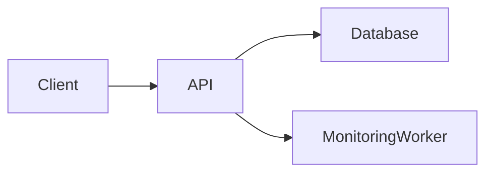

# استانداردهای Documentation پروژه FreelanceOps

## هدف

این سند استاندارد اصلی برای نوشتن و نگهداری Documentation پروژه FreelanceOps است.

تمام Documentation های جدید باید مطابق این قواعد نوشته شوند تا ساختار پروژه منظم، قابل جستجو و قابل نگهداری باقی بماند.

---

## 1. محل Documentation

تمام Documentation های پروژه باید داخل پوشه زیر قرار بگیرند:

```text
/docs
```

فایل `README.md` در Root Repository فقط به عنوان صفحه ورودی پروژه استفاده می شود و باید کوتاه باشد.

جزئیات فنی، Product Documentation، Architecture، Setup Guide، Decision Record و سایر مستندات باید داخل `/docs` قرار بگیرند.

ساختار پیشنهادی:

```text
/
├── README.md
└── docs/
    ├── README.md
    ├── README.fa.md
    ├── PRODUCT_IDEA.md
    ├── PRODUCT_IDEA.fa.md
    ├── DOCUMENTATION_STANDARDS.md
    ├── ARCHITECTURE.md
    ├── ARCHITECTURE.fa.md
    ├── SETUP.md
    ├── SETUP.fa.md
    └── ...
```

---

## 2. فرمت فایل

تمام Documentation ها باید با فرمت Markdown و پسوند `.md` باشند.

فرمت های زیر برای Documentation اصلی پروژه استفاده نشوند:

- `.docx`
- `.pdf`
- `.txt`
- `.html`

در صورت نیاز به Export، نسخه اصلی همچنان باید Markdown باشد.

---

## 3. زبان Documentation

زبان اصلی Documentation می تواند فارسی باشد.

در صورت نیاز به نسخه English، فایل جداگانه ایجاد شود.

قاعده نام گذاری نسخه فارسی:

```text
DOCUMENT_NAME.fa.md
```

مثال:

```text
ARCHITECTURE.md
ARCHITECTURE.fa.md
```

اگر یک Document فقط فارسی است، داشتن نسخه English اجباری نیست مگر اینکه برای Developer، Contributor یا Integration خارجی نیاز باشد.

---

## 4. زبان اصطلاحات فنی

متن توضیحی می تواند فارسی باشد، اما اصطلاحات فنی، نام Technology ها، Protocol ها، Product ها، Tool ها و مفاهیم استاندارد فنی باید به English نوشته شوند.

### درست

- سیستم از PostgreSQL برای Database استفاده می کند.
- Authentication با JWT انجام می شود.
- Backend از REST API استفاده می کند.
- Deployment با Docker و Jenkins انجام می شود.
- SSL Certificate قبل از Expiration بررسی می شود.

### نادرست

- سیستم از پستگرس کیو ال استفاده می کند.
- احراز هویت با جی دبلیو تی انجام می شود.
- استقرار با داکر انجام می شود.

نام Technology نباید ترجمه یا فارسی نویسی شود.

---

## 5. Code، Command و Configuration

تمام موارد زیر باید English باقی بمانند:

- Code
- CLI Command
- File Path
- Environment Variable
- API Endpoint
- Database Table
- Field Name
- Class Name
- Function Name
- Package Name
- Repository Name
- Branch Name
- HTTP Method
- Error Message

مثال:

```bash
docker compose up -d
```

مثال:

```env
DATABASE_URL=
REDIS_URL=
JWT_SECRET=
```

در متن فارسی نیز نام متغیرها ترجمه نشوند.

---

## 6. نام فایل ها

نام فایل های Documentation باید:

- English باشند
- با حروف بزرگ نوشته شوند
- از `_` برای جدا کردن کلمات استفاده کنند
- معنی واضح داشته باشند

مثال مناسب:

```text
PRODUCT_IDEA.md
DOCUMENTATION_STANDARDS.md
DATABASE_SCHEMA.md
DEPLOYMENT_GUIDE.md
API_DESIGN.md
MONITORING_ARCHITECTURE.md
```

از نام های مبهم خودداری شود:

```text
notes.md
new.md
doc1.md
final.md
misc.md
```

---

## 7. ساختار هر Document

هر Document باید تا حد امکان ساختار مشخصی داشته باشد.

الگوی پیشنهادی:

```markdown
# عنوان

## هدف

## محدوده

## توضیحات

## ساختار / Architecture

## تصمیم ها

## مثال ها

## محدودیت ها

## موارد باز

## تاریخچه تغییرات
```

همه Section ها اجباری نیستند؛ فقط موارد مرتبط استفاده شوند.

---

## 8. Heading

فقط یک `H1` در هر فایل وجود داشته باشد.

ساختار Heading باید سلسله مراتبی باشد:

```markdown
# H1

## H2

### H3

#### H4
```

از پرش مستقیم از `H2` به `H4` خودداری شود.

---

## 9. لینک بین Documentation ها

برای لینک داخلی از Relative Link استفاده شود.

مثال:

```markdown
[Product Idea](PRODUCT_IDEA.md)
```

نه:

```text
https://github.com/.../docs/PRODUCT_IDEA.md
```

این کار باعث می شود لینک ها روی Branch، Fork و Clone نیز درست کار کنند.

---

## 10. Documentation باید همراه Code تغییر کند

اگر یک تغییر در Code باعث تغییر یکی از موارد زیر شود، Documentation مرتبط باید در همان Change به روز شود:

- Architecture
- Environment Variable
- API
- Database Schema
- Deployment Process
- Configuration
- User Flow
- Feature Behavior
- Monitoring
- Backup
- Authentication
- Security

Code جدید با Documentation قدیمی یک Change ناقص محسوب می شود.

---

## 11. Documentation فنی باید دقیق باشد

در Documentation فنی از جملات مبهم مثل این خودداری شود:

> سیستم به Database وصل می شود.

بهتر:

> Backend از طریق `DATABASE_URL` به PostgreSQL متصل می شود.

یا:

> Worker هر 5 دقیقه Job های Monitoring را از Queue دریافت می کند.

تا جای ممکن مشخص شود:

- چه Component ای؟
- با چه Technology ای؟
- از چه Protocol ای؟
- با چه Configuration ای؟
- چه زمانی؟
- با چه Dependency ای؟

---

## 12. Secret و Credential

هیچ Secret واقعی نباید در Documentation نوشته شود.

ممنوع:

- Password
- API Token
- Private Key
- Access Token
- Database Password
- Production Credential

در مثال ها Placeholder استفاده شود:

```env
DATABASE_URL=postgresql://user:<password>@db:5432/freelanceops
API_TOKEN=<your-api-token>
```

---

## 13. تاریخ و Version

برای تاریخ های فنی از فرمت ISO استفاده شود:

```text
2026-10-22
```

برای Software Version از Version واقعی استفاده شود:

```text
PostgreSQL 17
Node.js 24
```

اگر Version هنوز قطعی نیست، Version حدس زده نشود.

---

## 14. Status های پیشنهادی

در Documents مربوط به Plan، Feature یا Architecture می توان Status مشخص کرد:

```text
Status: Draft
Status: Proposed
Status: Accepted
Status: Implemented
Status: Deprecated
```

خود Status باید English باشد تا در تمام Documentation ها یکسان بماند.

---

## 15. Documentation برای Decision های مهم

Decision های مهم فنی نباید فقط در Chat، Issue یا Commit باقی بمانند.

برای Decision هایی مثل این Document ساخته یا Update شود:

- انتخاب Database
- انتخاب Backend Framework
- Authentication Strategy
- Queue Architecture
- Monitoring Architecture
- Backup Strategy
- Deployment Strategy
- Multi-tenancy
- Notification Architecture

در صورت زیاد شدن Decision ها می توان در آینده از ADR استفاده کرد:

```text
/docs/adr/
```

---

## 16. Screenshot و Diagram

در صورت نیاز به Image یا Diagram، فایل ها داخل مسیر زیر قرار بگیرند:

```text
/docs/assets/
```

مثال:

```text
/docs/assets/architecture-overview.png
/docs/assets/client-flow.svg
```

لینک Image در Markdown باید Relative باشد.

---

## 17. Mermaid

برای Diagram هایی که قابل نمایش با Mermaid هستند، Mermaid به Image ثابت ترجیح داده می شود.

مثال:



مزیت این روش این است که Diagram همراه Code قابل Version Control و Edit است.

---

## 18. Commit مربوط به Documentation

Commit Message های Documentation بهتر است با `docs:` شروع شوند.

مثال:

```text
docs: add Persian product documentation
docs: document monitoring architecture
docs: update deployment guide
docs: add API authentication flow
```

---

## 19. اصل نگهداری دو نسخه زبانی

اگر یک Document دارای نسخه English و Persian است، هر تغییر معنی دار باید در هر دو نسخه اعمال شود.

دو نسخه نباید از نظر محتوا به مرور از هم جدا شوند.

برای مثال:

```text
PRODUCT_IDEA.md
PRODUCT_IDEA.fa.md
```

این دو فایل باید یک مفهوم و Scope یکسان داشته باشند، حتی اگر ترجمه آن ها کلمه به کلمه نباشد.

---

## 20. اصل نهایی

Documentation باید بخشی از خود Product محسوب شود، نه یک کار جانبی.

قاعده پروژه:

> اگر یک Developer جدید نتواند با خواندن `/docs` بفهمد سیستم چیست، چرا ساخته شده، چگونه کار می کند و چگونه باید روی آن کار کند، Documentation کافی نیست.


---

## 21. ثبت Documentation جدید در Root README

هر Documentation جدیدی که داخل `/docs` اضافه می شود باید در همان Change داخل فایل Root Repository یعنی:

```text
/README.md
```

نیز ثبت شود.

برای هر Document جدید، Root `README.md` باید شامل این موارد باشد:

- Relative Link به فایل
- نام Document
- توضیح کوتاه درباره هدف Document و اینکه برای چه کاری استفاده می شود

مثال:

```markdown
- [MVP Definition](docs/MVP_DEFINITION.fa.md) — تعریف Scope نسخه اول Product و تصمیم های اصلی MVP.
```

هدف این Rule این است که Root `README.md` همیشه Index اصلی Documentationهای پروژه باقی بماند و یک Developer یا Contributor جدید بتواند بدون جستجو در Folderها، Document مناسب را پیدا کند.

اضافه کردن Document جدید بدون Update کردن Root `README.md` یک Documentation Change ناقص محسوب می شود.

اگر Document حذف، Rename یا Deprecated شود، Entry مربوط به آن در Root `README.md` نیز باید در همان Change اصلاح شود.
